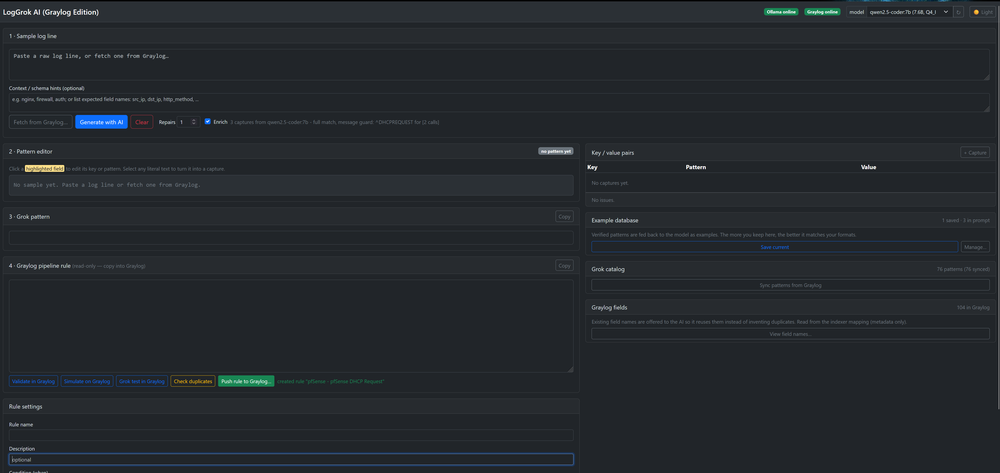

# LogGrok AI

Turn a raw log line into a verified [Graylog](https://graylog.org/) pipeline rule with a local LLM.

Paste or fetch a log message, let a local [Ollama](https://ollama.com/) model propose grok
captures, then review and edit the result in the browser. The app verifies every
proposal against a bundled grok catalog, repairs captures that do not match, and
renders a ready-to-push Graylog pipeline rule. Nothing is sent to a cloud LLM.




## Features

- **Local AI generation** - Ollama proposes an ordered list of literal text and
  grok captures for a sample line; no hosted LLM or API key required.
- **Deterministic verification** - captures are anchored back onto the sample
  and compiled locally. A partial match is sent back for repair with a verified
  shortlist of patterns that actually match each failing value.
- **Enrichment pass** - one optional extra round adds structured fields the
  model left as literal text (for example a timestamp or HTTP status code).
- **Visual capture editor** - edit keys and patterns, promote selected text to a
  capture, and see the generated grok and rule update live.
- **Guard conditions** - a message matcher is derived from the sample and
  generalized, so the rule does not depend on a port, IP, timestamp, or username
  from one specific message.
- **Graylog integration (optional)** - browse recent messages, hide messages
  already covered by a rule, reuse existing field names, validate with
  `rule/parse`, simulate against the original message, check for duplicate
  rules, push the rule, and add it to a pipeline stage.
- **Learned examples** - fully matching patterns are stored locally and fed
  back to the model as few-shot examples, improving results for your formats.
- **Pattern catalog sync** - import the grok patterns defined by your Graylog
  instance so local validation uses the same definitions.

## Requirements

| Component | Notes |
| --- | --- |
| Python | 3.11 or newer (3.12+ recommended) |
| Ollama | Local server with at least one chat model |
| Graylog | Optional. Graylog 6.x/7.x with an API token for the push/search features |

The app is a Flask development server with no authentication. Run it on your
own machine and keep it bound to localhost.

## Quick start

### 1. Install Ollama and a model

Install Ollama from <https://ollama.com/download>, then make sure the server is
running:

```bash
ollama serve
```

In another terminal, pull the default model:

```bash
ollama pull qwen2.5-coder:7b
```

Other models work too. Small code-oriented models tend to follow the JSON
segment format best. You can switch models in the app's model selector.

### 2. Clone and install the app

```bash
git clone https://github.com/fordayinlife/ai_grok_pattern_builder
cd ai_grok_pattern_builder
```

Create a virtual environment and install the runtime dependencies:

```bash
python3 -m venv .venv
source .venv/bin/activate        # Windows: .venv\Scripts\activate
pip install -r requirements.txt
```

Install the test dependency if you want to run the suite:

```bash
pip install pytest
```

If your Linux distribution blocks virtualenv/pip with PEP 668 and you cannot use
`venv`, install into your user site as a fallback:

```bash
pip3 install --user --break-system-packages -r requirements.txt pytest
```

### 3. Configure

```bash
cp .env.example .env          # Windows: copy .env.example .env
```

Edit `.env`. The defaults work with a stock local Ollama install; Graylog values
are optional.

| Variable | Default | Purpose |
| --- | --- | --- |
| `OLLAMA_BASE_URL` | `http://localhost:11434` | Ollama server URL |
| `OLLAMA_MODEL` | `qwen2.5-coder:7b` | Model used when the UI has no explicit selection |
| `OLLAMA_TIMEOUT` | `300` | Seconds to wait for a generation or repair call |
| `EXAMPLES_IN_PROMPT` | `3` | Learned examples injected into each prompt; `0` disables |
| `GRAYLOG_URL` | empty | Graylog API base URL, **including `/api`** |
| `GRAYLOG_TOKEN` | empty | Graylog API access token |
| `GRAYLOG_VERIFY_SSL` | `true` | Set `false` only for a trusted self-signed certificate |
| `GRAYLOG_FIELD_HINTS` | `true` | Offer existing Graylog field names to the model |
| `GRAYLOG_FIELD_HINTS_LIMIT` | `300` | Cap on field names injected into the prompt |
| `FLASK_HOST` | `127.0.0.1` | Interface the web server binds to |
| `FLASK_PORT` | `5000` | Web server port |

Example Graylog values:

```dotenv
GRAYLOG_URL=https://graylog.example.com:9000/api
GRAYLOG_TOKEN=your-api-token
```

The token is sent as the HTTP Basic **username** with the literal password
`token`, which is how Graylog API tokens work. The account behind the token needs
permission to read messages, inputs, fields, grok patterns, pipeline rules, and
pipelines, plus permission to create/update pipeline rules and pipelines. An
administrator token is the simplest setup; use a least-privilege token for a
shared or production instance.

Graylog features degrade gracefully: with `GRAYLOG_URL` or `GRAYLOG_TOKEN`
blank, AI generation and local rule rendering still work, while the Graylog
buttons report that it is not configured.

### 4. Run

```bash
python3 app.py
```

Open <http://127.0.0.1:5000>. The badges in the navbar show whether Ollama and
Graylog are reachable.

## Using the app

1. **Paste a sample.** Paste a raw log line, or click **Fetch from Graylog** and
   search recent messages. The fetch dialog can show only messages that no
   existing rule covers yet.
2. **Add context (optional).** Describe the log type or expected field names,
   for example `nginx access log; src_ip, method, path, status`.
3. **Generate.** Choose the repair count and whether to enrich, then click
   **Generate with AI**. The model returns literal text plus named captures.
4. **Review the pattern editor.** Captures are highlighted over the sample. Click
   a field to change its key or pattern, or select literal text and click
   **+ Capture** to add one manually. The match badge shows whether the pattern
   covers the whole sample.
5. **Check the grok and rule.** Sections 3 and 4 show the generated grok string
   and the complete Graylog pipeline rule.
6. **Tune rule settings.** Set the name, description, source field, and `when`
   condition. The message guard is applied automatically when available and can
   be edited under **Rule settings**.
7. **Validate against Graylog (optional).** Use **Validate in Graylog** for a
   syntax/type check, **Simulate on Graylog** to run the rule against the sample,
   and **Grok test in Graylog** to test the grok expression directly.
8. **Check duplicates (optional).** Compares the rule against existing rules and
   reports identical or close matches without blocking the push.
9. **Push.** **Push rule to Graylog** creates the rule with a unique title. If a
   message with an input title is loaded, you can also add the rule to stage 0 of
   a pipeline with the same name (creating the pipeline if needed).
10. **Teach the model.** A rule whose grok fully matches the sample is saved to
    the local example database automatically. You can also save, edit, delete,
    and clear examples from the UI.

### Repairs and enrichment

- **Repairs** (0-5) only keep a round when it improves the match and keeps every
  capture from the previous round. Repair is skipped once the pattern fully
  matches.
- **Enrich** runs exactly one extra pass when a full match may still contain
  structured data as literal text. It is kept only if it adds a matching capture
  without dropping any existing one.
- After the model rounds, a deterministic autofix substitutes the most specific
  catalog pattern for any capture that still fails to match its own value.

## How it works

```text
sample ──> Ollama segments ──> anchor captures ──> local grok compile
                                                      │
                                          full match? ─┴─ no ──> repair rounds
                                                      │             │
                                                      └── yes ──> enrich (once)
                                                                    │
                                                              autofix if needed
                                                                    │
                                                          grok + pipeline rule
```

The model is never trusted verbatim. Its text segments are used as positional
anchors to locate capture values in the sample, and every capture is compiled
locally. Escaping lives in one module (`rule_builder.py`) so literal gaps are
escaped consistently and rule strings are encoded exactly once.

### Project layout

| Path | Responsibility |
| --- | --- |
| `app.py` | Flask routes and the generate/verify/repair orchestration |
| `llm.py` | Ollama client, prompt construction, JSON extraction |
| `rule_builder.py` | Escaping, anchoring, grok/rule rendering, repair helpers |
| `grok_compiler.py` | Grok-to-Python-regex compiler and match status |
| `grok_catalog.py` | Bundled catalog plus optional Graylog-synced patterns |
| `rule_matcher.py` | Reads existing rules to decide whether a message is covered |
| `graylog_client.py` | Graylog 6/7 REST client (search, validate, simulate, push) |
| `examples.py` | Local few-shot example store with relevance ranking |
| `data/grok_patterns.json` | Bundled pattern catalog |
| `data/*.json` (user data) | Synced patterns and learned examples; gitignored |
| `templates/` + `static/` | Single-page Bootstrap UI |
| `tools/gen_patterns.py` | Regenerates the bundled catalog |
| `test_*.py` | Pytest suite (runs offline) |

`AGENTS.md` contains a deeper architecture and behavior reference for
contributors and coding agents.

## Testing

Run from the repository root:

```bash
python3 -m pytest -q
```

The tests do not need Ollama or Graylog; network access is mocked and field-name
hints are disabled by `conftest.py`.

To regenerate the bundled grok catalog after editing the pattern list:

```bash
python3 tools/gen_patterns.py
```

## API

The UI is backed by a small JSON API. The most useful routes:

| Method | Route | Purpose |
| --- | --- | --- |
| `GET` | `/api/health` | Ollama and Graylog reachability |
| `GET` | `/api/ollama/models` | Models available in Ollama |
| `GET` | `/api/patterns` | Bundled + synced grok catalog |
| `POST` | `/api/patterns/sync` | Import grok patterns from Graylog |
| `POST` | `/api/generate` | Generate and verify a grok pattern |
| `POST` | `/api/render` | Render grok/rule from edited captures |
| `POST` | `/api/captures/from-fields` | Turn an existing message's fields into captures |
| `POST` | `/api/messages` | Search messages, optionally hiding covered ones |
| `GET` | `/api/graylog/fields` | Existing Graylog field names |
| `POST` | `/api/graylog/grok-test` | Test a grok expression in Graylog |
| `POST` | `/api/rule/parse` | Validate a rule in Graylog |
| `POST` | `/api/rule/simulate` | Simulate a rule against the sample |
| `POST` | `/api/rule/duplicates` | Check for identical or similar rules |
| `POST` | `/api/rule/push` | Create the rule (and optionally reference a pipeline) |
| `GET/POST` | `/api/examples*` | List, add, update, delete, or clear examples |

## Troubleshooting

**Ollama badge is red / "cannot reach Ollama"**
Make sure `ollama serve` is running and `OLLAMA_BASE_URL` matches it. Check with
`curl http://localhost:11434/api/tags`. If Ollama runs in Docker or on another
host, point the variable at that address.

**The model is missing from the selector**
Pull it first (`ollama pull qwen2.5-coder:7b`) and refresh the model list.

**Generation times out**
Increase `OLLAMA_TIMEOUT`, use a smaller model, or close other work competing for
GPU/CPU. The first request after loading a model is usually the slowest.

**The pattern does not fully match the sample**
Raise the repair count, inspect the failing capture values, or edit the pattern
manually and use **+ Capture**. Enrich can recover timestamps and status codes
left as literal text. The catalog only contains patterns your target Graylog
understands.

**Graylog returns 401/403**
Check that `GRAYLOG_URL` includes `/api`, the token is current, and the account
has the pipeline/message permissions described above.

**SSL certificate errors**
Only for a trusted self-signed instance, set `GRAYLOG_VERIFY_SSL=false`.

**A rule validates in Graylog but extracts no fields**
Graylog returns HTTP 200 even when a rule cannot run (for example an undefined
grok pattern or a pattern that does not match the message). Use **Simulate** and
check which fields came back. Graylog 7.x does not define `HOST`, `VERSION`,
`JAVACLASS`, `JAVAFILE`, `JAVAMETHOD`, or `JAVASTACKTRACEPART`; sync the pattern
catalog from your instance if local and server definitions differ.

**Port 5000 is already in use**
Set a different `FLASK_PORT` in `.env`.

**Existing field names look stale**
Field hints are cached in-process for one hour. Use the refresh button in the
Graylog fields dialog or restart the app.

**The rule title already exists**
Graylog requires unique pipeline rule titles. The app appends `-2`, `-3`, and so
on automatically before creating the rule.

## Security notes

- There is **no login**. The Flask development server binds to `127.0.0.1` by
  default for a reason; do not expose it directly to an untrusted network.
- For shared use, put it behind an authenticating reverse proxy and set
  `FLASK_HOST` deliberately. The built-in Flask server is not a production
  server.
- The Graylog token lives server-side in `.env` and is never sent to the
  browser. `.env` is gitignored; do not commit it or paste real tokens into
  `.env.example`.
- Fetched log lines may contain sensitive data. Learned examples are stored
  locally in `data/examples.json`, which is gitignored.
- The app contacts only your configured Ollama and Graylog endpoints. The
  browser loads Bootstrap from a CDN.
- Use at your own risk

## AI Generation & "As-Is" Disclaimer

**Portions of this codebase and associated documentation were generated or assisted by Artificial Intelligence (AI).**

This project is provided strictly as a demonstration/proof-of-concept for educational and experimental purposes. The author makes no representations, warranties, or guarantees—express or implied—regarding the accuracy, completeness, security, reliability, or fitness for a particular purpose of the generated code.

The code may contain errors, omissions, unintended behaviors, or suboptimal implementations. You are solely responsible for reviewing, testing, auditing, and validating all logic, network calls, and syntax before executing it in any environment. 

Under no circumstances shall the author or copyright holder be held liable for any claim, damages, data loss, security compromise, service disruption, or other liability arising from the use of, or inability to use, this software. Use entirely at your own risk.

## License

[MIT](LICENSE) © 2026 fordayinlife

LogGrok AI is an independent open-source project and is not affiliated with, endorsed by, or sponsored by Graylog, Inc. Graylog is a registered trademark of Graylog, Inc.

Grok pattern definitions are derived from the StreamSets/logstash pattern
catalog. Bootstrap is served from jsDelivr under its own license.
